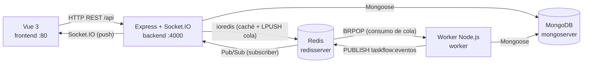

# TASKFLOW — Sistema Distribuido de Gestión y Procesamiento de Solicitudes

> **Programa de Formación:** Tecnólogo en Análisis y Desarrollo de Software (ADSO) — SENA
> **Competencia:** Implementar la solución de software de acuerdo con los requisitos de operación y modelos de referencia
> **Actividad de Aprendizaje:** Configurar los servicios requeridos del software mediante Docker Compose

**TASKFLOW** es una aplicación web Full Stack que recibe solicitudes de un usuario (información, soporte, trámites documentales, consultas y actualización de datos), las persiste, las encola y las procesa de forma **asíncrona** sin bloquear la experiencia de quien las registra.

Resuelve el problema de los **cuellos de botella** en la atención directa: el registro de una solicitud responde de inmediato y el procesamiento ocurre en segundo plano por un servicio aparte (el *Worker*).

---

## Tabla de contenido

1. [Descripción del proyecto](#1-descripción-del-proyecto)
2. [Tecnologías](#2-tecnologías)
3. [Arquitectura](#3-arquitectura)
4. [Servicios de Docker Compose](#4-servicios-de-docker-compose)
5. [Requisitos previos](#5-requisitos-previos)
6. [Instalación y ejecución](#6-instalación-y-ejecución)
7. [Variables de entorno](#7-variables-de-entorno)
8. [API REST](#8-api-rest)
9. [Flujo de procesamiento y estados](#9-flujo-de-procesamiento-y-estados)
10. [Eventos de Socket.IO](#10-eventos-de-socketio)
11. [Caché con Redis](#11-caché-con-redis)
12. [Estructura de carpetas](#12-estructura-de-carpetas)
13. [Pruebas obligatorias del taller](#13-pruebas-obligatorias-del-taller)
14. [Funcionalidades implementadas](#14-funcionalidades-implementadas)
15. [Flujo de trabajo con Git y GitHub](#15-flujo-de-trabajo-con-git-y-github)
16. [Solución de problemas](#16-solución-de-problemas)
17. [Integrantes](#17-integrantes)

---

## 1. Descripción del proyecto

TASKFLOW automatiza el ciclo de vida de una solicitud: desde su **radicación** en la interfaz web hasta su **respuesta automática** generada por una regla de negocio según la categoría. La arquitectura está desacoplada en servicios para que:

- El **frontend** (Vue 3) nunca hable directamente con MongoDB ni Redis.
- El **backend** (Express) reciba, valide, persista y **encola** (sin procesar).
- El **worker** (Node.js aparte) consuma la cola y genere la respuesta en segundo plano.

---

## 2. Tecnologías

| Capa / Servicio | Tecnología | Versión | Responsabilidad |
|---|---|---|---|
| Frontend | Vue 3 + Vite + Pinia + Vue Router + Socket.IO Client | vue `^3.5`, vite `^8`, socket.io-client `^4.8` | UI reactiva, rutas SPA y tiempo real |
| Servidor web | Nginx (Alpine) | `nginx:alpine` | Sirve el build estático de Vue |
| Backend API | Node.js + Express + Socket.IO Server | express `^4.21`, socket.io `^4.8` | API REST, validación y WebSockets |
| Persistencia | MongoDB + Mongoose | `mongo:7`, mongoose `^8` | Almacenamiento de solicitudes |
| Caché y cola | Redis (ioredis) | `redis:7-alpine`, ioredis `^5` | Caché cache-aside y cola FIFO |
| Worker | Node.js (consumidor de cola) | node `>=20` | Procesa solicitudes y publica eventos |
| Contenerización | Docker + Docker Compose | Compose v2 | Orquestación de los 5 servicios |

---

## 3. Arquitectura



### Reglas clave de la arquitectura

1. **El frontend nunca habla directo con MongoDB ni Redis.** Toda lectura/escritura pasa por la API de Express.
2. **Procesamiento asíncrono no bloqueante.** Al registrar, la API guarda en Mongo y encola en Redis (`LPUSH`); el worker consume con `BRPOP` en segundo plano.
3. **Comunicación interna por nombre de servicio.** Los contenedores se hablan con `mongoserver`, `redisserver`, etc. (nunca `localhost`).
4. **El worker no usa Socket.IO.** Publica eventos en el canal Redis `taskflow:eventos`; el backend está suscrito a ese canal y los retransmite por Socket.IO al frontend (`backend/config/pubsub.js`).

---

## 4. Servicios de Docker Compose

| Servicio | Imagen | Puerto interno | Puerto publicado (host) | Función |
|---|---|---|---|---|
| `mongoserver` | `mongo:7` | 27017 (no publicado) | — | Persistencia de solicitudes (volumen `mongo_data`) |
| `redisserver` | `redis:7-alpine` | 6379 (no publicado) | — | Caché y cola (volumen `redis_data`, `appendonly yes`) |
| `backend` | build `./backend` | 4000 | `${BACKEND_PORT:-4000}` | API REST + Socket.IO |
| `worker` | build `./worker` | — (sin puertos) | — | Consumidor BRPOP de la cola |
| `frontend` | build `./frontend` | 80 | `${FRONTEND_PORT:-8080}` | Vue 3 compilado + Nginx |

> **Importante:** MongoDB y Redis **no** exponen puertos al host; solo son accesibles dentro de la red de Compose. Los contenedores se comunican por nombre de servicio (`mongoserver:27017`, `redisserver:6379`). MongoDB usa un **volumen con nombre** (`mongo_data`), por lo que los datos sobreviven a reinicios y a `docker compose down` (sin `-v`).

---

## 5. Requisitos previos

- **Docker Desktop** (o Docker Engine + Compose v2) instalado y en ejecución.
- **Git** configurado.
- (Opcional) **Node.js 20+** y **npm**, solo si se quiere correr algún servicio fuera de Docker.

---

## 6. Instalación y ejecución

```bash
# 1. Clonar el repositorio
git clone https://github.com/JuanPa-CA/Taskflow.git
cd Taskflow

# 2. Construir y levantar todos los servicios (modo destacado)
docker compose up -d --build

# 3. Verificar que los 5 contenedores estén arriba
docker compose ps
```

### URLs de acceso

| Recurso | URL |
|---|---|
| Frontend (Vue) | http://localhost:8080 |
| Backend API | http://localhost:4000/api |
| Healthcheck backend | http://localhost:4000/api/health |
| Estadísticas | http://localhost:4000/api/estadisticas |
| Monitor | http://localhost:4000/api/monitor |

### Ver logs y detener

```bash
# Logs de un servicio (seguimiento en vivo)
docker compose logs -f backend
docker compose logs -f worker

# Detener sin borrar datos (volúmenes intactos)
docker compose down

# Detener y BORRAR volúmenes (datos de Mongo y Redis)
docker compose down -v
```

---

## 7. Variables de entorno

### Backend (`backend/.env.example`)

| Variable | Valor por defecto | Descripción |
|---|---|---|
| `NODE_ENV` | `development` | Entorno de ejecución |
| `PORT` | `4000` | Puerto del API Express |
| `MONGO_URI` | *(obligatoria)* | Conexión a Mongo (`mongodb://mongoserver:27017/taskflow`) |
| `REDIS_HOST` | *(obligatoria)* | Host de Redis (`redisserver`) |
| `REDIS_PORT` | *(obligatoria)* | Puerto de Redis (`6379`) |
| `REDIS_PASSWORD` | *(vacío)* | Contraseña de Redis (no se usa) |
| `REDIS_QUEUE_KEY` | `taskflow:queue:solicitudes` | Lista Redis usada como cola |
| `REDIS_EVENTS_CHANNEL` | `taskflow:eventos` | Canal Pub/Sub worker → backend |
| `REDIS_WORKER_HEARTBEAT_KEY` | `taskflow:worker:heartbeat` | Clave heartbeat del worker (Monitor) |
| `CACHE_TTL_SECONDS` | `60` | TTL del caché de estadísticas |
| `CORS_ORIGIN` | `http://localhost:5173` | Origen permitido (CORS/Socket.IO) |
| `RATE_LIMIT_WINDOW_MS` | `900000` | Ventana del rate limit (15 min) |
| `RATE_LIMIT_MAX` | `100` | Máx. peticiones por ventana |

### Worker (`worker/config/env.js`)

Lee las mismas variables de Redis/Mongo (`MONGO_URI`, `REDIS_HOST`, `REDIS_PORT`, `REDIS_PASSWORD`, `REDIS_QUEUE_KEY`, `REDIS_EVENTS_CHANNEL`) y además `REDIS_WORKER_HEARTBEAT_KEY` (por defecto `taskflow:worker:heartbeat`).

### Frontend (build args de Docker)

| Variable | Valor en Compose | Descripción |
|---|---|---|
| `VITE_API_URL` | `http://localhost:4000/api` | Base URL del API (se incrusta al compilar) |
| `VITE_SOCKET_URL` | `http://localhost:4000` | URL del servidor Socket.IO |

---

## 8. API REST

Todas las rutas van bajo el prefijo `/api`.

| Método | Endpoint | Descripción | Respuesta (resumen) |
|---|---|---|---|
| GET | `/api/health` | Liveness del backend | `{ ok, servicio, estado }` |
| POST | `/api/solicitudes` | Registra y encola una solicitud | `201 { ok, data }` |
| GET | `/api/solicitudes` | Listado con filtros y paginación | `{ ok, items[], total, page, limit, totalPages }` |
| GET | `/api/solicitudes/:id` | Detalle por id | `{ ok, data }` (o `404`) |
| GET | `/api/solicitudes/:id/respuesta` | Solo la respuesta del worker | `{ ok, data }` (o `404`) |
| GET | `/api/estadisticas` | Indicadores del Dashboard (con `origen`) | `{ ok, origen, data }` |
| GET | `/api/monitor` | Estado real de los 4 servicios | `{ ok, servicios, generadoEn }` |

**Ejemplo — POST /api/solicitudes**

```bash
curl -X POST http://localhost:4000/api/solicitudes \
  -H "Content-Type: application/json" \
  -d '{"titulo":"Problema con el correo","descripcion":"No puedo enviar correos desde la app","categoria":"Soporte","prioridad":"media"}'
```

Respuesta `201`:

```json
{ "ok": true, "data": { "id": "6acd...", "titulo": "Problema con el correo", "categoria": "Soporte", "prioridad": "media", "estado": "EN COLA", "respuesta": null } }
```

**Ejemplo — GET /api/estadisticas**

```json
{ "ok": true, "origen": "cache", "data": { "total": 7, "pendientes": 0, "enCola": 0, "procesando": 0, "respondidas": 7, "errores": 0, "colaRedis": 0, "generadoEn": "..." } }
```

El campo `origen` vale `"mongo"` (CACHE MISS) o `"cache"` (CACHE HIT).

**Ejemplo — GET /api/monitor**

```json
{ "ok": true, "servicios": { "express": { "status": "Conectado", "ok": true }, "mongodb": { "status": "Conectado", "ok": true }, "redis": { "status": "Conectado", "ok": true }, "worker": { "status": "Conectado", "ok": true } }, "generadoEn": "..." }
```

---

## 9. Flujo de procesamiento y estados

El ciclo de vida de una solicitud:

```
PENDIENTE → EN COLA → PROCESANDO → RESPONDIDA
                       └────────→ ERROR
```

1. **PENDIENTE**: la API guarda la solicitud en MongoDB (estado inicial).
2. **EN COLA**: la API hace `LPUSH` del id en la cola Redis y actualiza el estado.
3. **PROCESANDO**: el worker hace `BRPOP` (lo saca de la cola) y lo marca.
4. **RESPONDIDA**: el worker guarda la respuesta generada.
5. **ERROR**: si ocurre una excepción al procesar, el worker guarda `mensajeError` y marca `ERROR`.

### Categorías y respuesta predefinida

| Categoría | Respuesta del worker (resumen) |
|---|---|
| `Información` | Confirma recepción e indica el horario de atención (lunes a viernes 8:00 a.m. – 5:00 p.m.). |
| `Soporte` | Pasos de autodiagnóstico (verificar conexión, reiniciar, datos actualizados) y correo `soporte@taskflow.local`. |
| `Documento` | Requisitos (documento de identidad, formulario, soportes) y plazo de 3 a 5 días hábiles. |
| `Consulta` | Informa que el trámite está registrado y disponible para seguimiento. |
| `Actualización` | Indica actualizar datos desde el perfil y plazo de 1 a 2 días hábiles. |
| *(cualquier otra)* | Respuesta genérica: "será atendida por un agente a la mayor brevedad posible". |

> Las reglas viven en `worker/services/reglas.service.js` como un mapa `categoría → función`.

### Cómo se produce el ERROR controlado

Según el código (`worker/worker.js` + `worker/services/reglas.service.js`), el worker envuelve todo el procesamiento en un `try/catch`: **cualquier excepción** (por ejemplo, un fallo al guardar en Mongo, o `generarRespuesta` recibiendo una categoría vacía/corrupta) convierte la solicitud al estado `ERROR` con un `mensajeError` amigable, sin detener el loop ni a las demás solicitudes. No existe un botón/endpoint dedicado a "provocar" el error desde la interfaz (ver [discrepancias](#discrepancias-o-dudas)).

---

## 10. Eventos de Socket.IO

El backend expone los eventos (retransmitidos al frontend). El worker publica por Pub/Sub y el backend los re-emite.

| Evento | Emisor | Significado |
|---|---|---|
| `solicitud-creada` | Backend | La solicitud quedó guardada en MongoDB |
| `solicitud-encolada` | Backend | La solicitud entró a la cola Redis (`EN COLA`) |
| `solicitud-procesando` | Worker (vía Pub/Sub) | El worker la tomó de la cola |
| `solicitud-respondida` | Worker (vía Pub/Sub) | Respuesta guardada en MongoDB |
| `solicitud-error` | Worker (vía Pub/Sub) | Fallo controlado al procesar |
| `cola-actualizada` | Backend y Worker | Cambió la longitud de la cola |

El worker **no** usa Socket.IO: publica en el canal Redis `taskflow:eventos` mensajes `{ "evento": "...", "data": {...} }` y el backend (suscriptor en `backend/config/pubsub.js`) los retransmite por Socket.IO.

---

## 11. Caché con Redis

Se implementa **cache-aside** en `backend/services/cache.service.js`:

- **CACHE MISS**: la clave no existe en Redis → se ejecuta la consulta a Mongo, se guarda en Redis con TTL y se devuelve `origen: "mongo"`.
- **CACHE HIT**: la clave existe → se devuelve desde Redis con `origen: "cache"`.

| Elemento | Valor real |
|---|---|
| Clave de estadísticas | `taskflow:cache:estadisticas` |
| TTL | `CACHE_TTL_SECONDS` = **60 s** |
| Invalida | Al crear/encolar una solicitud (`solicitudes.service.js` borra `taskflow:cache:estadisticas` y el patrón `taskflow:cache:solicitudes:listado*`) |

La demostración en la UI consulta `GET /api/estadisticas`: la 1.ª consulta es MISS y la siguiente (dentro de 60 s) es HIT.

---

## 12. Estructura de carpetas

```text
Taskflow/
├── docker-compose.yml          # Orquestación de los 5 servicios
├── README.md                   # Este documento
├── backend/                    # API REST (Express + Socket.IO)
│   ├── Dockerfile
│   ├── app.js                  # Configura Express (middlewares + rutas + errores)
│   ├── server.js               # Arranque: Mongo + Redis + HTTP + Socket.IO + shutdown
│   ├── config/                 # constants, db, env, pubsub, redis, socket
│   ├── controllers/            # estadisticas, monitor, solicitudes
│   ├── middlewares/            # errorHandler, notFound, rateLimiter, validateRequest
│   ├── models/                 # Solicitud.js
│   ├── routes/                 # estadisticas, index, monitor, solicitudes
│   └── services/               # cache, estadisticas, monitor, queue, solicitudes
│
├── worker/                     # Consumidor asíncrono (BRPOP)
│   ├── Dockerfile
│   ├── worker.js               # Loop BRPOP + heartbeat + shutdown
│   ├── config/                 # constants, db, env, redis
│   ├── models/                 # Solicitud.js (mismo schema que el backend)
│   └── services/               # publisher.service.js, reglas.service.js
│
└── frontend/                   # Cliente Vue 3
    ├── Dockerfile              # Multi-stage (Node + Nginx)
    ├── nginx.conf              # try_files para Vue Router (SPA)
    ├── vite.config.js          # Alias @/ y puerto dev 5173
    └── src/
        ├── App.vue             # Raíz (MainLayout + router-view + listeners Socket.IO)
        ├── main.js             # Bootstrap (Pinia, Router, plugins)
        ├── assets/             # logo.svg
        ├── components/         # BtnPrimario, BtnSecundario, Header, RequestCard,
        │                       # RequestForm, StatCard, StatusBadge, TableSolicitudes
        ├── composables/        # useRequests.js, useSocket.js
        ├── layouts/            # MainLayout.vue
        ├── plugins/            # axios.js, socket.js
        ├── router/             # index.js
        ├── services/           # requestService.js
        ├── store/              # requestStore.js (Pinia)
        ├── styles/             # main.css
        ├── utils/              # formatDate.js, validateRequest.js
        └── views/              # DashboardView, MonitorView, NewRequestView,
                                # RequestDetailView, RequestsView
```

---

## 13. Pruebas obligatorias del taller

### 1. Registro (Vue → MongoDB)

- **Objetivo:** registrar una solicitud desde la UI y verificar que quedó en MongoDB.
- **Comandos / pasos:** ir a `/solicitudes/nueva`, llenar el formulario y enviar.

```bash
# Equivalente por API:
curl -X POST http://localhost:4000/api/solicitudes \
  -H "Content-Type: application/json" \
  -d '{"titulo":"Prueba de registro","descripcion":"Verificar persistencia","categoria":"Soporte","prioridad":"media"}'
```

- **Resultado esperado:** aparece la tarjeta de confirmación con ID y la solicitud queda en MongoDB.


### 2. Respuesta (solicitud procesada)

- **Objetivo:** el worker procesa y genera una respuesta según la categoría.
- **Pasos:** abrir `/solicitudes/:id` y esperar el paso `PROCESANDO → RESPONDIDA`.
- **Resultado esperado:** se muestra la respuesta automática según la categoría.


### 3. Cola (detener worker y encolar 5 solicitudes)

```bash
docker compose stop worker
# registrar 5 solicitudes (por UI o repitiendo el curl)
curl http://localhost:4000/api/estadisticas   # observar "colaRedis": 5
```

- **Resultado esperado:** las 5 quedan en estado `EN COLA` y `colaRedis = 5`.


### 4. Recuperación (iniciar worker)

```bash
docker compose start worker
```

- **Resultado esperado:** el worker consume las pendientes y pasan `PROCESANDO → RESPONDIDA`.


### 5. Caché (MISS y luego HIT)

- **Pasos:** en `/solicitudes` o `/monitor`, pulsar "Demostrar Caché (HU-08)".
- **Resultado esperado:** la 1.ª consulta marca **CACHE MISS (MongoDB)** y la siguiente (dentro de 60 s) **CACHE HIT (Redis)**.


### 6. Persistencia (reinicio sin borrar datos)

```bash
docker compose restart            # o: docker compose down && docker compose up -d
```

- **Resultado esperado:** las solicitudes siguen intactas gracias al volumen `mongo_data`.


### 7. Error controlado

- **Objetivo:** evidenciar el paso a `ERROR` sin tumbar el worker.
- **Cómo:** según el código, el `ERROR` se dispara cuando falla el guardado en Mongo o cuando `generarRespuesta` recibe una categoría vacía/corrupta (no hay botón dedicado en la UI; ver [discrepancias](#discrepancias-o-dudas)).
- **Resultado esperado:** la solicitud pasa a `ERROR` con `mensajeError` y las demás se siguen procesando.


### 8. Responsive

- **Pasos:** verificar en móvil, tableta y escritorio (DevTools → device toolbar).
- **Resultado esperado:** menú hamburguesa, tarjetas y tabla responsive sin desbordamiento.


---

## 14. Funcionalidades implementadas

- Registro de solicitudes con validación (título, descripción, categoría, prioridad).
- Listado con filtros (categoría, prioridad, estado) y búsqueda, en tabla y tarjetas.
- Detalle con stepper del ciclo de vida y respuesta del worker.
- Dashboard con métricas y solicitudes recientes.
- Monitor con estado de los 4 servicios, métricas de cola y registro de eventos en vivo.
- Procesamiento asíncrono con cola Redis (BRPOP) y respuestas por categoría.
- Caché cache-aside (HU-08) con indicador HIT/MISS.
- Tiempo real vía Socket.IO + Redis Pub/Sub.


---

## 15. Flujo de trabajo con Git y GitHub

```text
Issue en GitHub
      ↓
Creación de rama (feature/… o fix/…)
      ↓
Desarrollo + commits descriptivos
      ↓
Push a GitHub
      ↓
Pull Request (PR)
      ↓
Revisión (Code Review)
      ↓
Merge a main
      ↓
Cierre del issue (closes #N)
```

### Convención de ramas (observada en el repositorio)

- `main`: código estable.
- `feature/<tema>` o `feature/<n>-<tema>`: por ejemplo `feature/backend-setup`, `feature/frontend-taskflow`, `feature/worker-setup`, `feature/18-docker-compose`.
- `fix/<n>-<tema>`: por ejemplo `fix/16-formulario-solicitud`, `fix/20-cache-monitor`.

---

## 16. Solución de problemas

### Puerto ocupado (4000 u 8080)

```bash
# Cambiar los puertos publicados con variables de entorno
BACKEND_PORT=4100 FRONTEND_PORT=8090 docker compose up -d
```

### El frontend no llega al backend

La URL del API se incrusta al compilar (build arg `VITE_API_URL`). Si cambias el puerto del backend, reconstruye el frontend:

```bash
docker compose up -d --build frontend
```

### MongoDB tarda en arrancar

El `depends_on` de Compose espera el `healthcheck` de Mongo. Si aún así falla el backend al inicio:

```bash
docker compose logs mongoserver
docker compose restart backend
```

### Cambios de código que no se reflejan

Reconstruye la imagen (la caché de capas puede ocultar cambios):

```bash
docker compose up -d --build
```

### Reiniciar desde cero (borrando datos)

```bash
docker compose down -v      # borra volúmenes (mongo_data, redis_data)
docker compose up -d --build
```

---

## 17. Integrantes

| Nombre completo | Usuario de GitHub | Aporte principal |
|---|---|---|
| Nombre completo: (completar) | [JuanPa-CA](https://github.com/JuanPa-CA) | |
| Nombre completo: (completar) | [LiaMeyy](https://github.com/LiaMeyy) | |

---

## Discrepancias o dudas

1. **Puertos en documentación heredada.** El `backend/README.md` y `frontend/.env.example` mencionan el puerto `3000` (y el frontend en el puerto `80`), pero el `docker-compose.yml` real usa **4000** (backend) y **8080** (frontend). El `frontend/.env.example` (`VITE_API_URL=http://localhost:3000`) está desactualizado y, además, le falta el sufijo `/api`.
2. **Mongo y Redis no se publican al host.** No hay sección `ports:` para `mongoserver` ni `redisserver`; solo son alcanzables dentro de la red de Compose (no por `localhost:27017`/`6379` desde el host).
3. **`backend/README.md` describe una estructura que no existe.** Menciona `src/`, modelos de `categoria`/`contador`, `validators/`, `scripts/seed`, endpoints de `/categorias`, `/indicadores`, `/cache`, etc. El código real usa una estructura plana (`config/`, `controllers/`, `services/`, `routes/`) y solo tiene los endpoints listados en la sección 8.
4. **El listado `/api/solicitudes` no está cacheado.** Aunque `CACHE_KEY_SOLICITUDES_LISTADO` está definida y se invalida al crear, `listarSolicitudes` consulta Mongo directamente (sin `getOrSetCache`). Solo `/api/estadisticas` usa caché.
5. **Búsqueda y filtro por prioridad en el servidor.** El frontend envía `search` y `prioridad` como query params, pero el controlador del backend lee `buscar` (no `search`) y no filtra por `prioridad`. El filtrado por esos campos solo funciona del lado del cliente.
6. **Evento `monitor-actualizado`.** Está definido en las constantes de backend y worker, pero no lo emite ningún código actualmente.
7. **Error controlado sin disparador de UI.** No hay endpoint ni botón para "provocar" el `ERROR`; solo se alcanza por excepción interna (fallo al guardar en Mongo o categoría corrupta), lo cual es difícil de reproducir en la demo porque el backend valida la categoría.
8. **Métodos sin backend.** `actualizarSolicitud` y `eliminarSolicitud` existen en `frontend/src/services/requestService.js`, pero el backend no tiene rutas `PUT`/`DELETE` para solicitudes (solo `POST`, `GET /`, `GET /:id`, `GET /:id/respuesta`).
